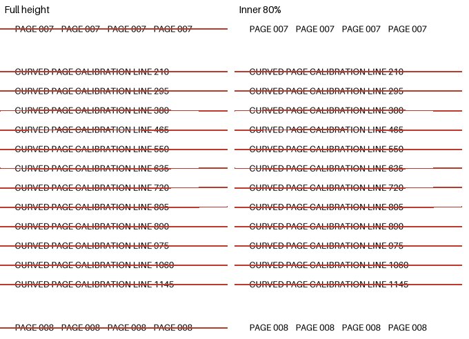

# Dewarping inner-band experiment (#223)

## Recommendation

Keep the automatic default at full height. The inner band removes the test
running page numbers, but it also removes real edge text and turns a valid
three-line fit into passthrough. A width or isolation filter is worth testing
against annotated scanner pages before changing the default.

The experimental `dewarp_inner_band: true` stage parameter restricts automatic
baseline tracking to row centers between 10% and 90% of the dewarp input height.
It defaults to false. Manual and off mode use the same behavior in both runs.
This is a branch-only setting. Use it with `dewarp_mode: auto` in the stage API.

| Page | Baselines, full → inner | Baselines outside band at full height | Estimated maximum shift, full → inner |
| --- | ---: | ---: | ---: |
| Synthetic mild curl | 18 → 18 | 0 | 18.09 → 18.09 px |
| Synthetic strong curl | 18 → 18 | 0 | 47.91 → 47.91 px |
| Synthetic running page numbers | 14 → 12 | 2 | 1.29 → 1.29 px |
| Synthetic tight margins, real first and last lines | 3 → 0 usable | 2 | 0.22 → 0 px, passthrough |
| Boston Cooking-School Cook Book A, body crop | 29 → 25 | 3 | 153.13 → 76.49 px |
| Boston Cooking-School Cook Book B, body crop | 28 → 23 | 5 | 203.19 → 141.14 px |

The shift is the historical baseline model's maximum vertical displacement,
in input pixels. Changing the band can change the tracking seeds and spacing.
For A the four-curve drop includes a change beyond the three original outer
baselines. Both photographed pages still applied the current cylindrical
stage with either setting. The smaller predicted shifts do not establish
better correction at page edges. The crops lack annotated first and last
body lines.

The historical synthetic calibration agreed with the
[existing curvature measurements](curvature-acceptance.md). The corrected
RMS was 0.084 px for mild and 0.500 px for strong curl under both settings.
The sparse fixture keeps the existing warning and unchanged output after
filtering leaves too few baselines.



Run the comparison with the pinned photographs used by
[`page_dewarp`](https://github.com/mzucker/page_dewarp/tree/d3257d7b564bff994187a872d00537bc2fda7d3d/example_input).
The script checks the original hashes and applies the EXIF orientation and
body crops documented in the earlier measurement.

```sh
uv run python -m scripts.measure_dewarp_inner_band --photos /path/to/pinned-jpegs
uv run pytest -q tests/test_curvature.py
```
